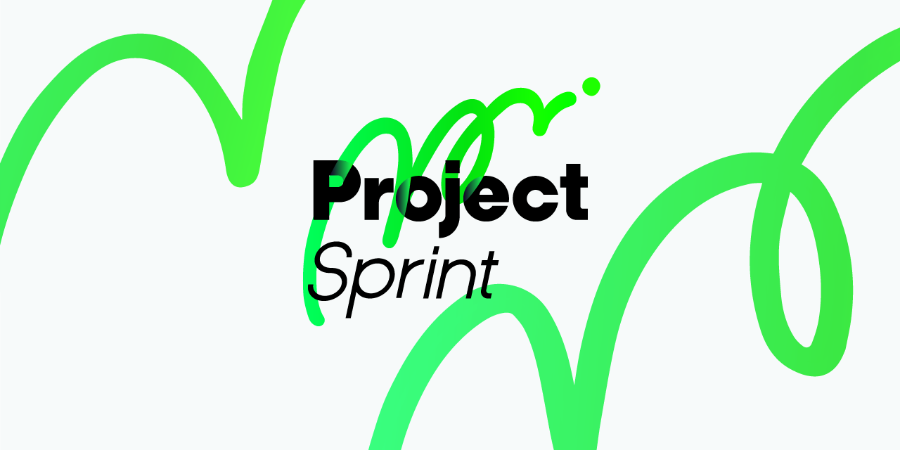

# Project Sprint

<p align="center">
  
</p>

Project Sprint は、不確実な状況においてプロジェクトを前進させるためのフレームワークです。

Project Sprint では、プロジェクトを「あらかじめ定めた正解を実行する活動」ではなく、「行動を通じて理解を更新し、価値を探索する活動」と捉えます。探索と収束のリズムを通じて、多様な個人の行動をチームとして統合し、価値の実現へとつなげる仕組みを提供します。

本リポジトリでは、Project Sprint をオープンソースのフレームワークとして公開しています。

## 📍 サイト

**https://www.projectsprint.org/**

このリポジトリの `docs/` 配下の Markdown がサイトのソースです。`main` にマージされた変更は、GitHub Actions によって自動的にサイトへ反映されます。

| 内容 | サイト | ソース |
| --- | --- | --- |
| Workshop（体験する） | [/workshop/](https://www.projectsprint.org/workshop/) | `docs/workshop/` |
| CODE v5.0（理解する） | [/code/](https://www.projectsprint.org/code/) | `docs/code/` |
| Practical Guide（実践する） | [/practical-guide/](https://www.projectsprint.org/practical-guide/) | `docs/practical-guide/` |
| Community | [/community/](https://www.projectsprint.org/community/) | `docs/community/`, `CONTRIBUTING.md` |
| Release Notes | [/releases](https://www.projectsprint.org/releases) | `docs/releases.md` |
| 過去バージョン（v4.3 / v3.3 / v2.2） | [/archive/](https://www.projectsprint.org/archive/) | `docs/archive/` |
| English（CODE v5.0 の英訳、En v2.0） | [/en/](https://www.projectsprint.org/en/) | `docs/en/` |

▼ 現在の最新ドキュメント（v5.0）

* [Introduction](docs/code/introduction.md)：まずは Project Sprint の全体像を把握しよう
* [Step0](docs/code/step0.md)：個人としてどのように探索に参加するかを理解しよう
* [Step1](docs/code/step1.md)：チームとしてどのように探索を進めるかを理解しよう
* [Key Terms](docs/code/keyterms.md)：主要な用語の定義を確認しよう

▼ 体験型 Project Sprint

* [Workshop](https://www.projectsprint.org/workshop/)：Google Gemini 上でひとりで進める自習型の体験（目安 15 分、Google アカウントが必要）

## 🙆‍♂️ こんな方におすすめ

Project Sprint は、プロジェクトを「価値を探索しつづける活動」と捉える人のためのフレームワークです。もしあなたが、現在のプロジェクトにおいて次のような感覚を持っているなら、Project Sprint は新しい視点を提供できるかもしれません。

- 計画どおりに進めることよりも、本当に価値のあるものを実現したい
- 環境や要求の変化に振り回されるのではなく、それらを踏まえて前進したい
- 多様なメンバーの視点や専門性を、よりよい意思決定につなげたい
- 管理や指示によってではなく、自律的な協働によってチームを動かしたい
- 今のプロジェクトの進め方に違和感があり、別の可能性を探している

※ Project Sprint におけるプロジェクトの捉え方について、さらに詳しくは [Introduction](docs/code/introduction.md) をご覧ください。

## 🛠 Project Sprint づくりに参加する

質問・提案・貢献の方法は [CONTRIBUTING.md](CONTRIBUTING.md) をご覧ください。

## 💻 サイトをローカルで確認する

```bash
npm ci
npm run docs:dev
```

本番と同じ静的ファイルを生成するには `npm run docs:build` を実行します（出力先は `docs/.vitepress/dist/`）。

## 🤝 クレジット

Project Sprint は、2020 年に[株式会社コパイロツト](https://copilot.jp/)（COPILOT Inc.）が起点となって公開され、2025 年に Project Sprint Org へ移管されました。コパイロツトは現在も、メンテナーの参加や週次ミーティングの運営を通じて Project Sprint の発展に協力しています。

## 📄 ライセンス

- 文書（`docs/` 配下の Markdown・画像・翻訳）: [CC BY-SA 4.0](LICENSE.md)
- サイトを生成するプログラムと設定（`docs/.vitepress/`、`.github/`、`package.json`）: [MIT](LICENSE-CODE.md)
