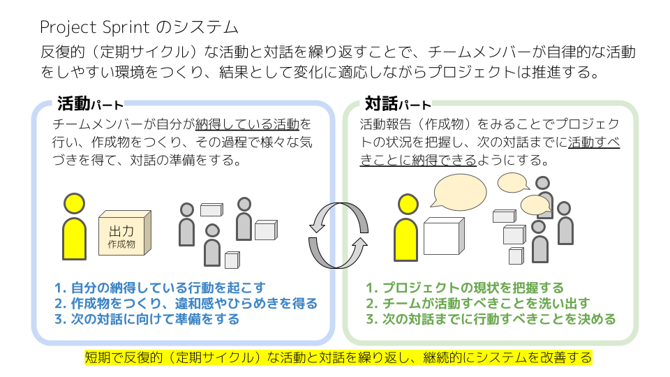
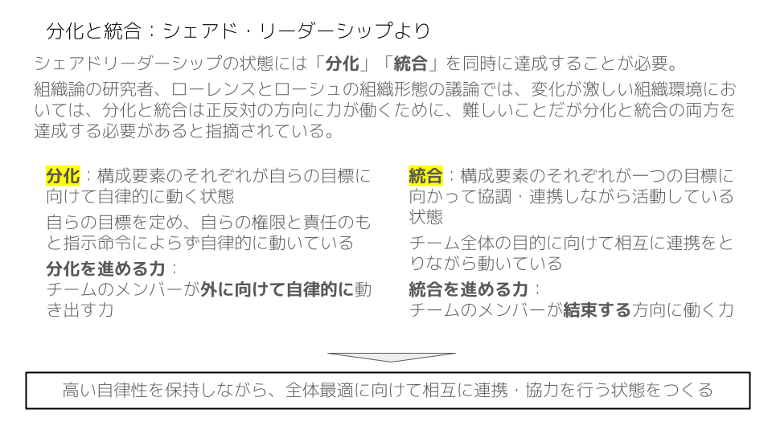
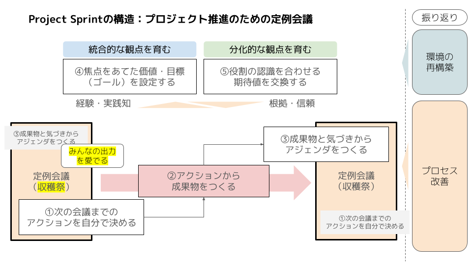

# Step0. The Individual Updates the World

> [!NOTE]
> **Position of this Step:**
>
> This Step focuses on the individual as the most basic unit in Project Sprint. 
> Before grasping the structure of the whole project or realizing outcomes as a team, the aim here is to reach a state in which each member can act, produce output, and engage with the world of their own accord. 
> The starting point of Project Sprint is not producing the right result, but first making it possible for the individual to take part in exploration.
>
> **Authors' intent:**
>
> - Share the basic attitudes of the individual that matter in Project Sprint: acting, producing output, observing, and proposing.
> - Show that an individual is someone who keeps updating their own understanding by acting on the world and observing the results.
> - Put "being able to act" and "being able to produce output" ahead of fitting the expected outcomes or integrating as a team.
>
> **Value for the reader:**
>
> - Understand how to take part in exploration as an individual in Project Sprint.
> - Gain a perspective for acting, producing output, and moving the project forward of your own accord, without being overly bound by outcomes or roles.
> - Feel how your own actions change the way the world appears to you, and so come to understand Project Sprint's exploratory view of projects from the inside.

---

## 1. Assumptions

> [!NOTE]
> **Position of this chapter:**
>
> This chapter shows the assumptions that anyone taking part in Project Sprint first needs to accept. 
> Before producing outcomes as a team, it prioritizes a state in which each member can act, produce output, and engage with the world of their own accord.
>
> **Authors' intent:**
>
> - As the starting point of Project Sprint, establish a state in which the individual acts on their own initiative and can bring their own observations and unease into the project.
> - Share the assumption that what moves a project forward is not "giving the right answer" but "acting, producing output, and updating the world."
>
> **Value for the reader:**
>
> - Understand how to act first as an individual in Project Sprint.
> - Gain a perspective for acting, producing output, and taking part in exploration of your own accord, without being overly bound by outcomes or roles.

We cannot fully understand the world. 
Each of us perceives the world on the basis of our own experience, knowledge, and interests. 
And so understanding is not updated by thinking alone. 
Only by actually acting and observing the results does the way the world appears to us change.

What matters in Project Sprint is not producing the right outcome from the start. 
What is needed first is to be able to act, to produce output, and to observe the results for ourselves.

What we output does not have to be a finished artifact. 
Unease, work in progress, trial and error, failures, and flashes of insight are also important information for moving the project forward.

Each member is treated as an agent who brings their own observations and thinking to the team and updates the project's understanding. 
Rather than asking the team "Is this right?", what matters is to tell the team what you observed, what you tried, and what you produced, and to propose what, given all that, you believe is best.

In Project Sprint, exploration means acting on the world and continually updating your own understanding through the results.

## 2. Structure: The Basic Cycle of Exploration and Convergence

> [!NOTE]
> **Position of this chapter:**
>
> This chapter presents the cycle of exploration and convergence, the smallest unit of Project Sprint. 
> Its purpose is to capture, in compact form, the structure of the process you experienced in the Workshop.
>
> **Authors' intent:**
>
> - Before entering the complex whole, make clear the smallest core movement of Project Sprint.
> - Give meaning to what the reader experienced in the Workshop, so that "what was happening" can be understood as an overall structure rather than as individual actions or steps.
>
> **Value for the reader:**
>
> - Move your understanding of the process you experienced in the Workshop from intuitive to structural.
> - Be able to explain the basic movement of Project Sprint (output, dialogue, convergence, next action) in your own words.

Project Sprint is a framework that moves a project forward by repeating small cycles of exploration and convergence. Several elements work together in its structure to make this happen.

Each member acts from their own perspective and interests, and outputs the artifacts and insights that result. What is output is brought to the team, where dialogue gives it meaning. In this process, understanding that lived inside one person is rebuilt as the team's. As a result, the shared understanding (not the same understanding, but one that lets the team act together; see Step1) is updated, and the team's next direction takes shape. On the basis of this updated shared understanding, each member chooses their next action out of conviction. New exploration then begins, and output is produced once again.

In Project Sprint, this sequence repeats, with the regular meeting as its unit. The regular meeting is the place where the understanding widened by exploration is brought to a temporary convergence, making the next action possible.

In this way, a project in Project Sprint moves forward by repeating exploration and convergence through output and dialogue. The process you experienced in the Workshop was designed to let you experience this basic cycle.

### Section 1. Exploration and Convergence through Output and Dialogue

The essence of a project lies in exploration. 
In uncertain situations, value and the right answer are not settled by a single judgment or plan; they are discovered through action.

A project moves forward by bringing its understanding to a temporary convergence on the basis of the results obtained through action, and then choosing the next action. This process is also an ongoing effort by the project team to keep updating, through its own actions, the way it sees the world. 
Project Sprint sees a project as proceeding through this succession of exploration and convergence. This presupposes that diverse individuals interpret the world from their own perspectives and bring the results into the project.

Output is the act of exploration from which the structure of Project Sprint begins. 
The artifacts and insights that each member produces by acting bring new information to the project. Without this information, the team cannot update its understanding of the situation. 
Output is not merely a means of producing finished artifacts; it is a means of understanding the world. The flashes of insight and the unease that arise in the course of acting are treated as important information for the project. 
In Project Sprint, exploration is sustained by continuous output.

Dialogue is the process of convergence that gives meaning to the information brought by output. 
On its own, each member's output stays locked inside that individual. Only when it is brought to the team and interpreted through dialogue is it shared as the team's understanding. 
In this process, members are not expected to agree in their perceptions. What matters is to create a state in which members, each keeping their own understanding, grasp the situation roughly and can align the direction of their actions. 
Dialogue has the role of connecting individual output to shared understanding.

The repetition of output and dialogue is the rhythm of exploration and convergence, and at the same time the rhythm of differentiation and integration (members diverge as each explores on their own, then integrate what they found through dialogue). 
Project Sprint is a structure that keeps updating the project's understanding and action by keeping this rhythm going.

<em>Source: Jun Ishikawa (2016), シェアド・リーダーシップ：チーム全員の影響力が職場を強くする (Shared Leadership: How the Influence of Every Team Member Strengthens the Workplace), Chuokeizai-sha.</em>

### Section 2. The Regular Meeting as a Mechanism

The regular meeting is a mechanism that deliberately gives the project a rhythm of progress by imposing convergence at fixed intervals. 
Because a project keeps changing, convergence does not occur on its own. 
To move forward in an integrated way as a team, however, temporary convergence has to be brought about regularly. 
Convergence makes it easier for artifacts to take shape, and easier for the next action to begin.

Each member's output is brought to the regular meeting, where dialogue gives it meaning. As a result, the shared understanding is updated and the direction of the next action takes shape. 
This is not mere information sharing; it is the project members themselves deciding, by their own will, how convergence will take place. 
Repeating this convergence regularly sustains the alternation of exploration and convergence.

### Section 3. The Regular Meeting as a Harvest Festival

Project Sprint treats the regular meeting as a "harvest festival."

The results of each member's attempts and trial and error are treated not as mere reports, but as outcomes that update the project's understanding. 
Through dialogue they are gathered in by the team and given meaning within the project. 
The harvest consists not in the result of the output itself, but in the meaning given to it.

In this process, an individual's actions are not things to be evaluated; they are material for the next action. 
Having seen where their output now sits within the project, each member chooses their next action out of conviction.

By redefining the regular meeting as a harvest festival, each individual's trial and error is welcomed and integrated into the team's understanding. 
Each member celebrates the results of their actions as a harvest, even though the schedule has cut those actions off at a fixed point. A fitting touch of wistfulness is part of the occasion. 
As a result, the material needed for the next action is in each member's hands, and each chooses and takes on their next action of their own will.

A harvest festival is a place where the results of action are brought to a point of convergence and taken up again as meaning. 
In Project Sprint, the regular meeting is a structure that generates conviction and self-directed action through this harvest.

### Section 4. Reflection

In Project Sprint, reflection is the process by which the team gives meaning to the output and insights so far, and updates the project's perception and structure.

The main aim of reflection is not to evaluate the past, but for the team to turn toward the future using past experience as a guide. 
Reflection is not about making perceptions coincide; it is about re-forming the shared understanding that makes the next action possible.

Reflection deals with the following two aspects at the same time.

- **Updating the perception of the environment**

  Update how the project understands the world. 
  On the basis of the outcomes and insights gained from the output so far, reinterpret "what we are aiming for" and "what is needed for it." 
  In this process the team adjusts both what integrates it (value, goals) and what differentiates it (roles, expectations).

- **Updating the process**

  Update the way the project itself is run. 
  Share concerns and ideas about how the project is run and organized with the team, make sense of them together, and build them into the project once the team is convinced. 
  In this way, the project's process is continuously optimized in response to the situation.

Through reflection, the project does not merely move forward; it keeps updating the way it moves forward. 
It is an ongoing effort to keep reconstituting the structure of the project while adjusting the relationship between differentiation and integration.

## 3. Mindset: The Attitude of an Agent Taking Part in Exploration

> [!NOTE]
> **Position of this chapter:**
>
> This chapter shows the attitude with which each member is expected to take part in the cycle of exploration and convergence in Project Sprint. 
> It deals with the basic stance of an agent who acts on the world and takes on their own actions, before any question of outcomes or roles.
>
> **Authors' intent:**
>
> - Share the basic attitudes of the individual that matter in Project Sprint: sincerity, responsibility, autonomy, and integrity.
> - Show the importance of taking part in exploration not merely by processing tasks, but by engaging with the world yourself and taking on the results.
> - Help you understand the thinking about collaboration that lies behind the dialogue and output you experienced in the Workshop.
>
> **Value for the reader:**
>
> - Understand the attitude with which an individual is expected to act, produce output, respond to the output of others, and engage with the project in Project Sprint.
> - Learn to see yourself not merely as a worker, but as someone who takes part in exploration on their own initiative.

In Project Sprint, each member is not simply someone who carries out an assigned role. Each is treated as an agent who observes the world, feels unease, acts, and brings the results into the project. Project Sprint therefore puts first the individual's taking on of their own actions.

What matters here is not giving the right answer from the start. What is important is to observe, think, and act for yourself, however imperfectly, and to output the results sincerely.

Sincerity does not mean behaving correctly. It means bringing into the project, without hiding them, the facts you have observed and the unease you have felt. Likewise, responsibility in Project Sprint does not mean not failing. It means taking on your own actions and output of your own will.

In this sense, Project Sprint does not ask members to be passive executors. It asks each of them to engage with the world themselves, as an agent taking part in exploration.

Exploration means changing the world, and at the same time, continuing to change yourself.
