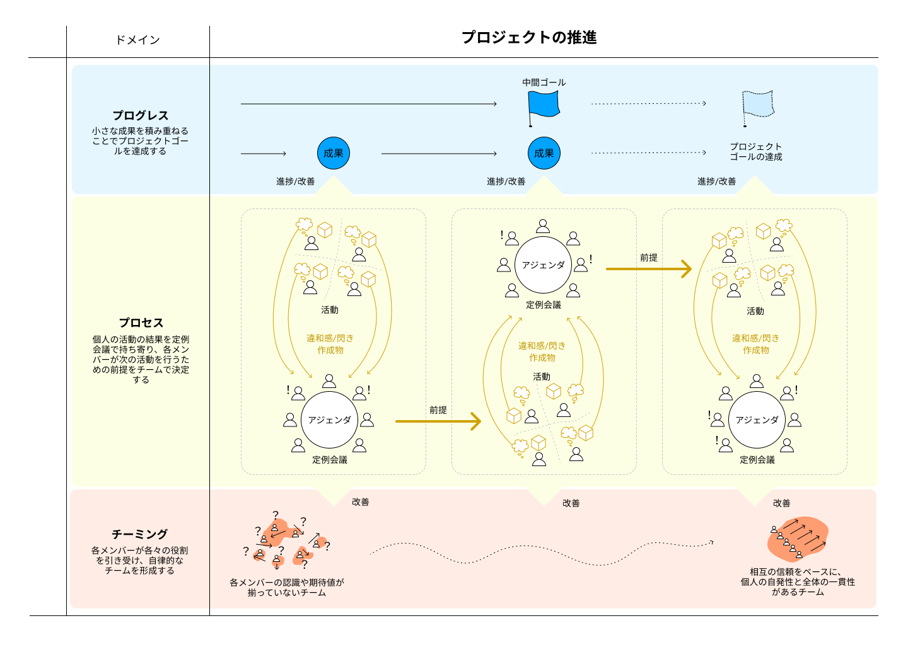

# Step1. Sharing Our Perception of the World with Others

> [!NOTE]
> **Position of this Step:**
>
> This Step connects the individual exploration dealt with in Step0 to exploration as a team. 
> In Project Sprint, a project does not yet exist simply because individuals can act and produce output. 
> This is because, as long as each member is heading in a different direction, the project cannot be said to be moving forward. 
> This Step deals with a state in which the team forms a shared understanding through interaction with others, and carries exploration forward while sharing "what we are heading toward."
>
> **Authors' intent:**
>
> - Show that in Project Sprint, interaction with others and shared understanding are indispensable for exploration and convergence to take place as a team.
> - Starting from the constraint that people cannot fully understand one another, make clear how to form relationships that nonetheless allow us to move forward together.
> - Show the importance not only of free individual exploration, but of adjusting one's own actions and understanding while receiving responses from others.
>
> **Value for the reader:**
>
> - Understand how to relate to others and how to form a shared understanding in Project Sprint.
> - Gain a perspective for carrying exploration forward as a team while collaborating with members who hold different perspectives and values.
> - See how interaction with others produces understanding and progress you could not have reached alone.
> - Understand the attitude of accepting that we can never fully understand one another, and moving forward together nonetheless.

## 1. Principles: The State Project Sprint Regards as Ideal

> [!NOTE]
> **Position of this chapter:**
>
> This chapter presents the values that serve as the criteria for judgment and action in Project Sprint. 
> Beyond understanding the structure, it provides the criteria for judging what to prioritize within it.
>
> **Authors' intent:**
>
> - Declare the values Project Sprint emphasizes, and make clear the thinking that serves as the criteria for judgment and action.
>
> **Value for the reader:**
>
> - Understand the values on which Project Sprint is designed, and gain a guide to what to prioritize within a project.

In Project Sprint, the following values are emphasized as the criteria for judgment when moving a project forward.

- **Output over plans** 
  A project moves forward through output, not through plans. 
  Output supplies the primary information with which the team understands the world and decides its next action.

- **Conviction over correctness** 
  Rather than searching for the one right answer, what matters is that members can act out of conviction (*nattoku*). 
  Conviction is the foundation on which each member takes on their own actions.

- **Autonomy over control** 
  The team moves not by centralized control, but by individual, autonomous judgment. 
  Members act independently, loosely coupled, and collaborate through shared understanding.

- **Commitment over skill** 
  What matters in a project is not being able to do things well from the start, but committing yourself and continuing to act. 
  Wholehearted action and output update the understanding of the team and the project.

These values do not ask you to choose one side only. 
While recognizing the importance of each, we value the item before "over" more highly. 
The structure of Project Sprint turns these principles into concrete action.

## 2. Assumptions

> [!NOTE]
> **Position of this chapter:**
>
> This chapter presents a way of seeing things that serves as the premise for understanding Project Sprint. 
> Project Sprint is not a mechanism that works by following particular procedures. It is truly effective only when the thinking behind it is understood. 
> The purpose of this chapter is not to explain Project Sprint, but to present a lens for looking at projects, one built into the assumptions of Project Sprint. 
> When you look at a project through that lens, the way problems and confusion appear changes. And as a result, why the structure of Project Sprint is the way it is should come to you not as an explanation, but as understanding.
>
> **Authors' intent:**
>
> - Make explicit the view of people, of the world, and of projects that Project Sprint presupposes, and share the philosophical foundation of the framework.
> - Make it possible to understand why Project Sprint exists as a framework, and why it is needed, so that readers can judge its value for themselves.
> - Provide criteria for adjusting one's attitude toward projects and toward relating to others.
>
> **Value for the reader:**
>
> - By understanding the thinking behind Project Sprint, grasp the framework together with its intent, rather than as a set of surface procedures.
> - By adjusting how you approach your own project in light of these assumptions, you can use Project Sprint more effectively.

### Section 1. The Worldview of Project Sprint

- **Accept that the world is always changing** 
  The world we face is always changing, and the future cannot be fully predicted. 
  How to deal with this fact, however, is left to the will and choice of the project team. 
  It is possible to run a project by holding to a plan made in advance, without treating change as a given. 
  But unless change is treated as a given, the new information and understanding gained through action are not put to full use. 
  In Project Sprint, a project is an activity that is updated and moves forward through action and its results amid uncertainty.

- **People cannot understand everything about the world** 
  The perception an individual holds is always limited, and no one can understand everything about the world. 
  There is a limit to what can be seen from a single perspective. 
  Some things become visible only when multiple, diverse perspectives are brought to bear. 
  The existence of diverse perspectives is therefore itself a premise for deepening understanding.

- **Understanding is updated through action** 
  People cannot understand the world sufficiently by thinking alone. 
  Understanding is updated through actually acting, and through the experience and outputs that result. 
  Action is not mere execution; it is a means of knowing the world.

- **Meaning can only be interpreted after the fact** 
  People cannot fully understand in advance the meaning or value of their own actions. 
  Only when the results of action appear, and are reflected on in dialogue with others, are they given meaning. 
  Meaning does not exist before action; it emerges after it.

- **Human perceptions can never be fully shared** 
  Each person has different experience and knowledge, and any understanding of the world is always personal and partial. 
  Perceptions therefore cannot be made to coincide completely. 
  What matters is not making perceptions coincide, but creating a state in which we can act together while taking our differences as a given. 
  In Project Sprint, this state is called "shared understanding."

- **People take on action when they are convinced** 
  Decision-making is not accomplished by logical correctness alone. 
  Only when people are convinced by their own judgment can they take on the action on their own initiative. 
  Conviction (*nattoku*) here refers to a state in which a person, on grounds of their own, is able to feel that something is "good." 
  Decision-making based on conviction generates autonomous action by individuals.

### Section 2. Basic Concepts in Project Sprint

> [!NOTE]
> **Position of this chapter:**
>
> This chapter focuses on the elements that make up Project Sprint and the relationships among them. 
> Project Sprint is not a collection of individual procedures and rules; it is a structure that works through the interaction of several elements. 
> It is therefore important not only to understand each element on its own, but to grasp how they connect and generate the rhythm of exploration and convergence. 
> This chapter makes those relationships clear, so that Project Sprint as a whole can be understood as a structure. 
> The detailed operation of each element is left to the Practical Guide; this chapter concentrates on understanding the structure itself.
>
> **Authors' intent:**
>
> - Show the elements that make up Project Sprint and their relationships, and make clear the structure by which a project moves forward through the rhythm of exploration and convergence.
>
> **Value for the reader:**
>
> - Understand how Project Sprint generates the rhythm of exploration and convergence through elements such as output, dialogue, and reflection.
> - Grasp the mechanism by which a project keeps moving forward even in uncertain situations, as a set of relationships rather than as procedures.

- **What is a project?** 
  A project is an activity for exploring and realizing value amid uncertainty. 
  Value and the right answer are not settled in advance; they are discovered through action. 
  A project is therefore understood not as something that executes a plan, but as something that moves forward while updating its understanding. 
  The project itself is also a unit of convergence, one set up in order to realize value.

- **The relationship between value, outcomes, and output** 
  Project Sprint understands a project as a structure of three layers.
  - Output: the act by which project members produce artifacts or obtain information
  - Outcome: a result that has appeared in the world through output
  - Value: the meaning that outcomes bring to society or to customers 

  Each is described in detail below. 
  - **What is output?** 
    Output is the act by which project members produce artifacts or information through action. 
    In Project Sprint, the progress of a project begins with output. When each member acts and brings the concrete artifact that results to the team, individual activity is connected to the project. Even where perceptions are hard to align through verbal dialogue alone, sharing a concrete, visible artifact brings concerns and issues into the open. In this way, the insights and unease that lived inside one person reach the team, and shared understanding begins to form. 
    Nor is output merely a means of producing finished artifacts. The information gained in the course of acting, such as flashes of insight and unease, is important in itself, and becomes the trigger for the next action, keeping exploration going. 
    Output is also what receives meaning after the fact. On its own, an individual's action does not have a clear position or value within the project. Only through the dialogue that follows the output is its meaning interpreted and its role within the project recognized. In this way, output is the act that serves as the starting point for updating understanding, continuing exploration, and leading to convergence.
  - **What is an outcome?** 
    An outcome is a change that has appeared inside or outside the project as the result of the act of output. 
    It goes beyond the creation of artifacts to include changes in the situation, in perceptions, in relationships, and so on. 
    Outcomes exist as observable facts, and accumulate as the project proceeds.
  - **What is value?** 
    Value is the meaning or benefit that external stakeholders find in outcomes. Project success can be described as delivering this value to the customer. 
    Value is not inherent in the outcome itself; it is interpreted by whoever receives it. The same outcome may be given different meanings depending on the situation and the standpoint. For the project team, value is not something fully defined in advance, but a hypothesis that gradually becomes clear through action and output.

- **What are exploration and convergence?** 
The essence of a project lies in exploration. 
In uncertain situations, value and the right answer are not settled by a single judgment or plan; they are discovered through action. A project moves forward by bringing its understanding to a temporary convergence on the basis of the results obtained through action, and then choosing the next action. Project Sprint sees a project as proceeding through this succession of exploration and convergence. 
This presupposes that diverse individuals use their own abilities, interpret the world from their own perspectives, and bring the results into the project. Only when such diversity exists does the act of convergence have meaning, and only then does the project move in a direction the team feels is better.

- **What is the regular meeting?** 
The regular meeting is a mechanism for deliberately giving the project a rhythm of progress by repeating convergence at fixed intervals. 
The regular meeting must therefore be designed to satisfy the following three conditions. 
  - Short: the interval is short relative to the project's overall timescale.
  - Periodic: it is held at a fixed interval that follows people's existing habits (daily, weekly, biweekly, and so on).
  - Repetitive: it follows a fixed pattern (how it is run, the kinds and format of agenda items, and so on). 

  In the regular meeting, dialogue based on each member's output rebuilds the understanding that lived inside individuals as the team's. Through this process, the team's shared understanding is updated and the direction of the next action takes shape. 
  Repeating this convergence at a fixed rhythm also builds the environment and habits that let each member act autonomously.

- **What is a team?** 
A project team is a group of individuals who hold different perspectives and experience, and who are loosely connected through shared understanding. 
Each member acts autonomously as an agent who judges independently, and their output keeps updating the team's understanding. 
A team is not a place for unifying perceptions; it is a set of relationships for moving the project forward while drawing on diverse perceptions.

- **What is shared understanding?** 
Shared understanding is not a state in which members share exactly the same understanding. It refers to a state in which members, while each holding a different understanding, grasp one another's thinking and situation roughly, and can take integrated action toward a common purpose as a team. 
Rather than making perceptions coincide, it is the foundation for acting together while taking differences as a given; one could also call it the ground on which individual diversity can be put to use. 
Shared understanding is not fixed; it is continuously updated through output and dialogue.

- **What is conviction?** 
Conviction (*nattoku*) refers to a state in which a person, on grounds of their own, is able to feel that something is "good." 
In complex and uncertain situations, it is difficult to identify the one right answer in advance. What matters in decision-making is therefore not correctness, but that each member is convinced by the judgment and can take it on as their own action. The perception of the situation and the direction that form through shared understanding are what conviction rests on. Decision-making based on conviction generates autonomous action by individuals. 
Shared understanding is the premise for acting as a team; conviction is the condition for an individual to take on that action.

- **How to perceive a project** 
In Project Sprint, for convenience, a project is sometimes perceived in terms of the following three aspects. 
  - Progress: the elements concerned with realizing outcomes.
  - Process: the elements concerned with the project's environment and the way it is run.
  - Teaming: the elements concerned with the team's relationships and autonomy.

  Looking at each activity in the project through each of these three aspects lets the team see the significance and effect of that activity within the project more accurately and from more sides. When this perception is shared by the project team, each member can adjust their own actions to the situation and contribute to the progress of the project as a whole.

## Mindset: The Attitude of an Agent Sharing Exploration with Others

> [!NOTE]
> **Position of this chapter:**
>
> This chapter connects the "attitude of taking part in exploration as an individual" dealt with in Step0 to collaboration with others. 
> It deals with the attitude for forming a shared understanding and carrying exploration forward together, while standing on the premise that we can never fully understand one another.
>
> **Authors' intent:**
>
> - Show that in Project Sprint, for exploration and convergence to take place as a team, a stance of receiving the output of others, responding to it, and adjusting one's own actions is indispensable.
> - Share the view that exploration is not something completed alone, but an ongoing effort in which unexpected developments and value emerge through interaction.
>
> **Value for the reader:**
>
> - Understand how to engage with the output and perspectives of others, and how to connect them to collaboration, in Project Sprint.
> - Gain a perspective for deepening exploration as a team, not only for acting as an individual.
> - See how interaction with others produces understanding and progress you could not have reached alone.

In Project Sprint, a team is not a group whose perceptions coincide completely. Each member has different experience, knowledge, and interests, and sees the world differently. We therefore cannot fully understand one another. Project Sprint, however, does not try to eliminate these differences. On the contrary, it holds that the very existence of diverse perspectives enriches exploration. What matters is therefore not understanding others completely, but continuing to explore together while responding to their output.

To understand this way of collaborating, Project Sprint draws on the practice of jazz and of improv (improvisational theater). In these activities, the overall course is not fully decided from the start. Each participant offers their own expression, other participants respond to it, and the whole takes shape.

What matters here is not simply evaluating or correcting the expression of others. It is first to receive the other's expression, and then to layer your own expression on top of it. In improv, this is called the principle of "Yes, and."

In the same way, in Project Sprint, members observe the output of others and respond to it, updating the project's understanding and direction. In this process, unexpected developments arise, along with understanding that you could not have reached alone. Through interaction with others, exploration widens beyond the limits of the individual.

At the same time, engaging with others is not always comfortable. Your intent may not come across; you may face values and judgments different from your own. Even so, what supports a team's progress in Project Sprint is forming shared understanding and continuing to explore, through repeated dialogue and response.

Exploration does not mean updating the world by yourself alone. It means updating, as a team, the way the world appears, through interaction with others.
